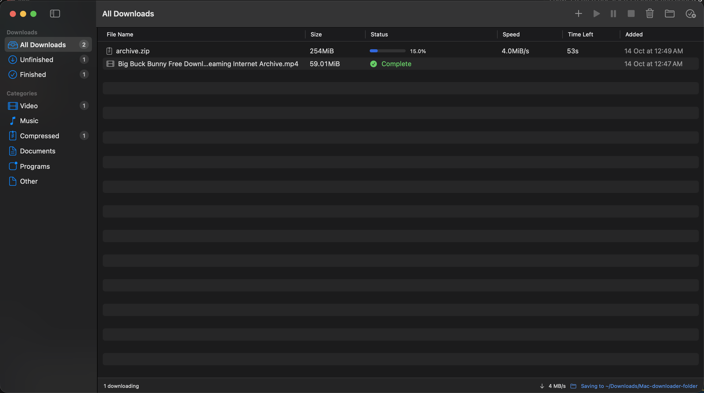
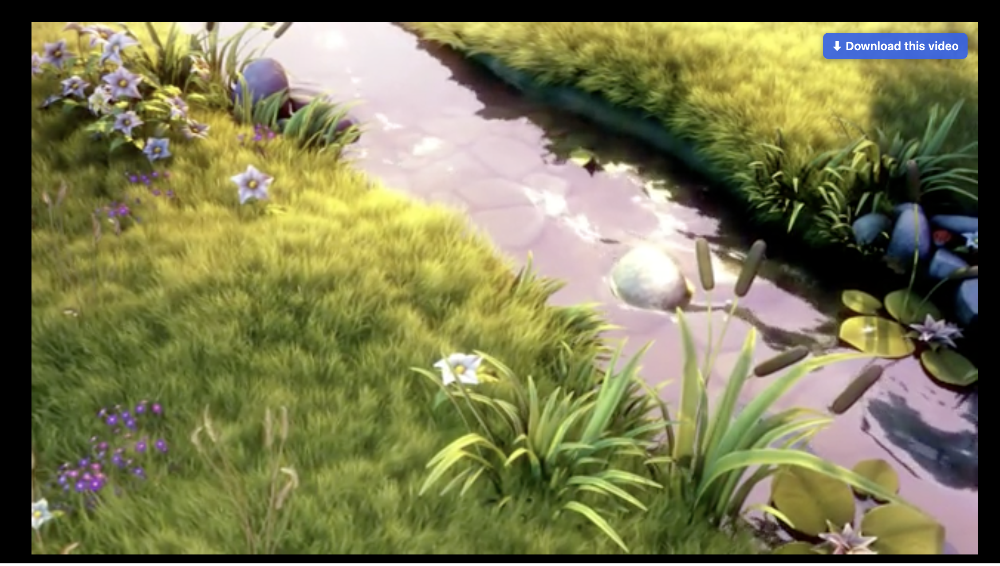
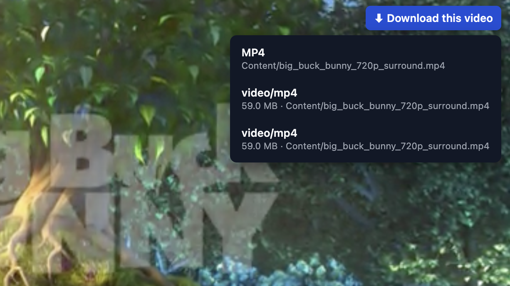

# Mac Download Manager

A free download manager for macOS, inspired by Internet Download Manager (IDM) on Windows.

It has two parts that work together:

- **A Mac app** that does the downloading: multiple connections per file for full speed, pause and resume, a download list with categories, and a folder of your choice.
- **A browser extension** for Chrome, Brave, Edge, Vivaldi and Chromium. It catches downloads when you click them and puts a **"⬇ Download this video"** button over videos on web pages.



| "Download this video" button | Choosing a stream |
|---|---|
|  |  |

## Features

- **Fast downloads.** Normal files (zip, dmg, iso, pdf and so on) download over 16 connections at once using [aria2](https://aria2.github.io/).
- **Video downloads.** YouTube and many other sites are handled by [yt-dlp](https://github.com/yt-dlp/yt-dlp), and video and audio are joined into one MP4 with [ffmpeg](https://ffmpeg.org/). Streaming videos (HLS `.m3u8` and DASH `.mpd`) are supported too.
- **Automatic capture.** Click a download link in your browser and it opens in Mac Download Manager instead of the browser's own downloader.
- **Video button.** A "Download this video" button appears over videos that are playing or that you hover over.
- **Pause, resume and cancel.** Downloads continue from where they stopped, even after a restart.
- **No speed limit.** Downloads use your connection's full speed.
- **Categories.** Downloads are grouped as Video, Music, Compressed, Documents, Programs and Other, plus Unfinished and Finished.
- **Custom download folder.** Pick a default folder, or a different one for a single download.
- **Runs in the background.** Downloads keep going if you close the window, the tab or the browser.
- **Notifications** when a download finishes or fails.

## Do I need both the app and the extension?

| Setup | What you get |
|---|---|
| **App only** | Everything except browser integration. Paste links into **Add URL** (⌘N) to download files or video pages. |
| **Extension only** | **Doesn't work.** The extension only passes links to the app. Without the app, the video button shows an error, and normal downloads just continue in the browser as usual. |
| **App + extension** (recommended) | The full experience: downloads are caught automatically, plus the video button and right-click menu. |

The app has to be **installed** for the extension to work, but it doesn't have to be **open**. The extension starts downloads in the background and brings the app window forward on its own.

## Requirements

**Required**

- **macOS 14 (Sonoma) or newer**, on Apple Silicon or Intel.
- **Xcode Command Line Tools**, which provide the Swift compiler used to build the app.

The app also uses a few free download tools. You don't need to install them yourself; the app's setup window downloads them for you:

- `yt-dlp` downloads from YouTube and other video sites.
- `ffmpeg` joins video and audio into one MP4.
- `deno` is needed by yt-dlp for YouTube.
- `aria2` (optional) speeds up plain file downloads with many connections. Install it with `brew install aria2` if you have [Homebrew](https://brew.sh).

If you already installed these with Homebrew, the app uses those.

**Optional (for browser integration)**

- **Google Chrome, Brave, Microsoft Edge, Vivaldi or Chromium.**

Safari and Firefox are not supported yet.

## Installation

### 1. Install the Xcode Command Line Tools (skip if you already have them)

```bash
xcode-select --install
```

To check whether they're installed, run `swift --version`. If it prints a version number, you're set.

### 2. Download this project

```bash
git clone https://github.com/ahmedayoub95/MacDownloadManager.git
cd MacDownloadManager
```

You can also click **Code → Download ZIP** on GitHub, unzip it, and `cd` into the folder.

### 3. Build and install the app

```bash
./scripts/install.sh
```

This builds the app (the first build takes a minute or two), installs it as **`~/Applications/Mac Download Manager.app`** and opens it.

> If macOS asks whether Mac Download Manager may send notifications, click **Allow** so you're told when downloads finish.

### 4. Follow the setup window

The first time the app opens, a **Setup** window walks you through three steps:

1. **Download tools.** Click **Install Missing Tools**. The app downloads yt-dlp, ffmpeg and Deno into its own folder; nothing is installed system-wide.
2. **Browsers.** The app connects itself to every supported browser you have installed. Nothing to click.
3. **Browser extension.** The extension isn't on the Chrome Web Store, so you add it by hand once:
   1. Click **Open Browser & Copy Address**, paste the address into the address bar and press Return.
   2. Turn on **Developer mode** (top-right corner; in Edge, the left sidebar).
   3. Click **Load unpacked** and choose the folder the setup window shows. **Show Extension Folder** opens it in Finder; in the file picker you can also press ⌘⇧G and paste the path from **Copy Folder Path**.
   4. Pin the extension from the puzzle-piece icon in the toolbar, and refresh any tabs that were already open.

When the extension loads, the setup window changes to **"Extension connected"** by itself. Click **Done**.

You can open this window again any time from **Mac Download Manager → Setup…** in the menu bar.

> Chrome may show a "Disable developer mode extensions" message when it starts. That's normal for extensions loaded this way; click the ✕ to keep it.

## How downloads start

There are four ways to start a download. In every case the file is saved to your download folder (`~/Downloads` unless you change it), and the Mac Download Manager window comes forward and shows progress.

### 1. Click a download link in the browser

Click a link to a file such as a `.zip`, `.dmg`, `.rar`, `.iso` or `.exe`. The extension catches the click before the browser starts downloading and sends the file to the app instead.

The app then downloads it over 16 connections, using your browser's login cookies so downloads that require you to be signed in still work.

Downloads the extension can't catch at the click (for example, ones that start after a redirect or a button press) are also taken over. Any download of a listed file type, or bigger than 20 MB, goes to the app.

PDFs, MP4s and MP3s usually **open in a browser tab** when clicked, so a normal click still opens them there. If the browser starts downloading them instead, the app takes over.

### 2. Click "⬇ Download this video" on a video

1. Open a page with a video, for example a YouTube video.
2. Play it or hover over it. A blue **⬇ Download this video** button appears in its top-right corner.
3. Click the button.
   - If the page has one video, the download starts right away.
   - If it has several streams (for example, different qualities), a list appears; pick one.
4. A message below the button confirms that the download started. If that video is already downloading, it tells you so instead.

YouTube videos download in two passes, video first and then audio, which the app then joins into one MP4. The app shows these stages: **Downloading (video)**, then **Downloading (audio)**, then **Joining video and audio…**, then **Complete**. Videos are saved as H.264 MP4s that play in QuickTime and everywhere else on a Mac, at up to 1080p on YouTube.

On sites other than YouTube, the button only knows about streams the page has actually loaded. If it says no stream was found, let the video play for a few seconds and try again.

### 3. Right-click a link or video

Right-click any link and choose **Download with Mac Download Manager**. On a video or audio element, choose **Download this media with Mac Download Manager**.

### 4. Add a link in the app (no extension needed)

1. In the app, click **+** in the toolbar or press **⌘N**.
2. Paste the link. If a link is already on your clipboard, it's filled in for you.
3. For YouTube, Vimeo, Instagram and similar sites, **This is a video page** is ticked automatically.
4. Optionally enter a file name, or click **Change…** to save this download somewhere else.
5. Click **Download**.

## Using the app

| Action | How |
|---|---|
| Pause / resume | Select a download and click ⏸ or ▶ in the toolbar, or right-click it |
| Cancel | Select it and click ⏹ |
| Open a finished file | Double-click it |
| Show a file in Finder | Right-click → **Show in Finder**, or the 📁 toolbar button |
| Remove from the list | Right-click → **Remove from List** (the file is kept) |
| Delete the file | Right-click → **Move File to Trash** |
| Clear the list | Toolbar → **Clear Finished** |
| Filter downloads | Click a category in the sidebar |

**Keeping the app running**

- Closing the window doesn't quit the app. Click its Dock icon or press **⌘0** to bring the window back. Use **⌘Q** to quit.
- To start it automatically, turn on **Open Mac Download Manager at login** in **Settings** (⌘,).
- To keep it in the Dock, right-click its Dock icon → **Options → Keep in Dock**.
- If it isn't running, open it from Spotlight (⌘Space, type "Mac Download Manager") or from `~/Applications`. The browser extension also starts it automatically when you download something.

**Changing the download folder**

- **Mac Download Manager → Settings** (⌘,) → **Change…**, or
- Click **"Saving to …"** in the bottom-right corner of the window.

The new folder applies to new downloads. Downloads that are running or paused finish in the folder they started in.

## Extension popup and settings

Click the extension's icon to see:

- Whether the app is connected.
- Switches to turn download capture and the video button on or off.
- Your downloads, with live progress.
- The videos found on the current page.

Click **Settings** in the popup to change:

- **File types** that are sent to the app.
- **Size limit:** any download bigger than this is sent to the app. The default is 20 MB; 0 turns it off.
- **Sites to leave alone:** downloads from these domains always stay in the browser.

## Updating

After pulling new changes:

```bash
git pull
./scripts/install.sh
```

Then reload the extension: on `chrome://extensions`, click the **↻** reload icon on Mac Download Manager, and refresh any open tabs.

The app keeps its own copy of yt-dlp up to date automatically (checked once a day), because video sites change often. If you use Homebrew's yt-dlp instead, run `brew upgrade yt-dlp` now and then.

## Troubleshooting

**The popup says "App not found"**
- Open **Mac Download Manager → Setup…** and click **Connect Again**.
- Fully quit and reopen the browser (⌘Q, not just closing the window).
- Make sure the extension was loaded from the folder shown in the setup window (or this project's `extension` folder). The app only accepts the extension with the ID `pgfkdonjalnlcemopglppogdghdghigg`.

**The "Download this video" button doesn't appear**
- Refresh the page. Tabs opened before the extension was installed or reloaded don't have it.
- Check that **Show "Download this video" button** is turned on in the popup.
- The video has to be at least 200×120 pixels, and either playing or under your mouse.

**The button says "The extension was updated. Reload this page"**
- The extension was reloaded after the page was opened. Refresh the page.

**A YouTube download fails**
- Most YouTube failures come from an outdated yt-dlp. The app updates its own copy daily; if you use Homebrew's, run `brew upgrade yt-dlp`.

**The browser still shows a "Save As" window**
- Turn off **Ask where to save each file before downloading** in your browser's Settings → Downloads.

**A download fails or gets stuck**
- Hover over **Failed** in the app to see the error.
- Select the download and click ▶ to retry it. It continues from where it stopped.
- Detailed logs:
  - `~/Library/Logs/MacDownloadManager/native-host.log`: every download request.
  - `~/Library/Logs/MacDownloadManager/jobs/<id>.log`: the full output of each download.

**A download fails with "Missing yt-dlp / ffmpeg / deno"**
- Open **Mac Download Manager → Setup…** and click **Install Missing Tools**.

## Uninstalling

1. **Remove the extension:** on `chrome://extensions`, click **Remove** on Mac Download Manager.
2. **Quit the app**, then delete it:
   ```bash
   rm -rf ~/Applications/"Mac Download Manager.app"
   ```
3. **Remove the browser registration and app data:**
   ```bash
   for b in "Google/Chrome" "Google/Chrome Beta" "Google/Chrome Canary" "Chromium" \
            "BraveSoftware/Brave-Browser" "Microsoft Edge" "Vivaldi"; do
     rm -f ~/Library/Application\ Support/"$b"/NativeMessagingHosts/com.ahmed.downloadmanager.json
   done
   rm -rf ~/Library/Application\ Support/MacDownloadManager
   rm -rf ~/Library/Caches/MacDownloadManager
   rm -rf ~/Library/Logs/MacDownloadManager
   defaults delete com.ahmed.MacDownloadManager.shared 2>/dev/null
   ```
4. The tools the app downloaded are removed with its data folder above. If you installed any with Homebrew, remove them with `brew uninstall yt-dlp ffmpeg aria2`.

Files you downloaded are not touched.

## Privacy and permissions

The extension asks for broad permissions. Here's what each one is used for:

| Permission | Why |
|---|---|
| Read and change data on all websites | To show the video button on any site and catch download links |
| Downloads | To take over downloads from the browser |
| Cookies | To pass your login to the app, so downloads that need you to be signed in still work |
| Web requests | To find the video streams a page loads |
| Native messaging | To talk to the Mac app |

- **Nothing is sent to the internet** except the downloads themselves.
- Cookies only go to the app on your own Mac and are only used for that download. They are never written to log files.
- While a download is unfinished, its request (including cookies) is kept in `~/Library/Application Support/MacDownloadManager/jobs/` so it can be resumed. Only your user account can read these files, and they're deleted when the download finishes or is cancelled.
- The project has no analytics and no tracking, and doesn't connect to any server of its own.

## How it works

```
Browser                              Mac
┌──────────────────────┐            ┌──────────────────────────────────────────┐
│ Extension            │  native    │ mdm-native-host (inside the app)         │
│  • catches downloads │ messaging  │  • receives links from the extension     │
│  • video button      │ ─────────► │  • starts a background worker for each   │
│  • right-click menu  │            │    download                              │
└──────────────────────┘            │                                          │
                                    │ Worker                                   │
                                    │  • aria2   → normal files (16 conns)     │
                                    │  • yt-dlp  → video pages and streams     │
                                    │  • ffmpeg  → joins video + audio         │
                                    │  • writes progress to a status file      │
                                    │                                          │
                                    │ Mac Download Manager app (SwiftUI)       │
                                    │  • reads status files, shows the list    │
                                    │  • pause / resume / cancel / settings    │
                                    └──────────────────────────────────────────┘
```

Each download runs in its own background process, so it keeps going when the app window, the browser tab or the whole browser is closed.

## Project structure

```
app/                         Swift package (the Mac app)
  Package.swift
  Sources/
    DownloadCore/            Download engine shared by the app and the helper
      Downloads.swift          start / pause / resume / cancel
      Worker.swift             runs aria2 or yt-dlp and tracks progress
      JobStore.swift           the shared download list, stored on disk
      Settings.swift           download folder setting
      Tools.swift              finds and installs yt-dlp, ffmpeg and Deno
      BrowserSetup.swift       connects the helper to each browser
      Models.swift             data types and paths
    MacDownloadManager/      SwiftUI app: window, Add URL, Settings, Setup
    mdm-native-host/         Helper the browser extension talks to
extension/                   Browser extension (Manifest V3)
  manifest.json
  background.js              Message handling and right-click menu
  content.js                 Video button and download-link capture
  lib/intercept.js           Taking over browser downloads
  lib/media.js               Finding video streams on each page
  lib/native.js              Talking to the Mac app
  popup.*  options.*         Toolbar popup and settings page
scripts/install.sh           Builds and installs the app
```

## Disclaimer

This tool is for downloading content you have the right to download: your own files, freely licensed media, or content whose owner allows downloading. Downloading copyrighted material without permission may break the law where you live and the terms of service of the website (YouTube's terms, for example, do not allow downloading in most cases). You are responsible for how you use this software.

Mac Download Manager does not and will not bypass DRM. Protected services like Netflix, Disney+, Prime Video and Spotify are not supported.

This project is not affiliated with Internet Download Manager, Tonec Inc., Google, YouTube, or the authors of yt-dlp, ffmpeg or aria2.

## License

This project is licensed under the [MIT License](LICENSE). You're free to use, copy, modify and share it, as long as the copyright notice is kept.

The download tools it runs are separate projects with their own licenses: [yt-dlp](https://github.com/yt-dlp/yt-dlp) (Unlicense), [ffmpeg](https://ffmpeg.org/legal.html) (LGPL/GPL) and [aria2](https://github.com/aria2/aria2) (GPL-2.0). They are downloaded from their official releases by the app's setup window (or come from Homebrew) and are not included in this repository.
